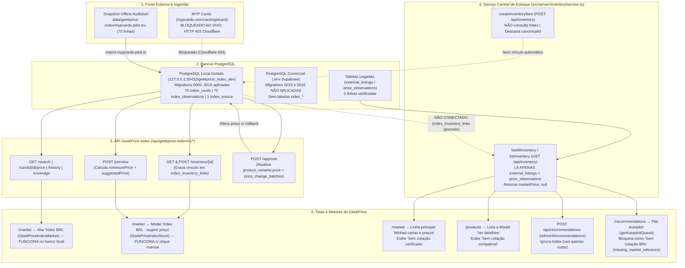

# GEEKPRICE — RELATÓRIO DE FLUXO DE DADOS DA PRECIFICAÇÃO BRASILEIRA (BRL DATA FLOW REPORT)

**Data da Auditoria:** 16 de outubro de 2026  
**Escopo:** Mapeamento técnico ponta a ponta do fluxo de preços em reais brasileiros (BRL) entre a fonte externa (MYP Cards), o banco PostgreSQL (`geekprice_index_dev` vs. Supabase comercial), a API GeekPrice Index (`/api/geekprice-index/v1/*`), o estoque do lojista (`/products`), a tela de Mercado (`/market`), o motor financeiro, o serviço de Recomendações e o Autopilot (`/recommendations`).

---

## 1. Visão Geral da Arquitetura Atual (Onde o Fluxo se Divide em Duas Trilhas Desconectadas)

A investigação de código, banco de dados e execução E2E em navegador real comprovou que o GeekPrice possui hoje **duas trilhas de referência de mercado BRL que não conversam entre si no serviço central de inventário**:

1. **Trilha Legada do Estoque (`listAllInventory` em `src/server/inventory/service.ts:292-360`):**
   - Alimenta `GET /api/inventory`, a tela `/products` (lista e modal `"Ver detalhes"`), a listagem principal de `/market` (`"Minhas cartas e preços"`), o motor de recomendações (`POST /api/recommendations`) e a fila principal do Autopilot (`GET /api/autopilot/queue`).
   - Calcula `item.marketPrice` **exclusivamente** a partir das tabelas legadas `external_listings` + `price_observations` (exigindo `rawPayload.verified === true`, `rawPayload.currency === "BRL"` e `rawPayload.printingExact === true`).
   - Como `external_listings` e `price_observations` estão **vazias (`0` linhas)**, **`item.marketPrice` é sempre `null`** em todo o sistema principal.

2. **Trilha Isolada do GeekPrice Index (`/api/geekprice-index/v1/*` em `src/server/geekprice-index/*`):**
   - Alimentada pelas novas tabelas `index_sources`, `index_cards`, `index_observations`, `index_runs` e `index_inventory_links` (migrations `0015_yellow_zodiak.sql` e `0016_Material_menace.sql`).
   - Está presente **somente no banco PostgreSQL portátil local (`127.0.0.1:55432/geekprice_index_dev`)** — e **não existe** no banco comercial configurado no `.env` (`postgres` no Supabase).
   - É consultada **apenas** em dois lugares da interface:
     1. Na aba exploratória `/market` → `"Index BRL"` (`src/components/geekprice-index-market.tsx`).
     2. No modal secundário `/market` → `"Minhas cartas e preços"` → botão `"Index BRL · sugerir preço"` (`src/components/geekprice-index-stock.tsx`), que chama `/api/geekprice-index/v1/inventory/[id]`, `/api/geekprice-index/v1/preview` e `/api/geekprice-index/v1/approve`.



---

## 2. Tabela Obrigatória de Status por Etapa (12 Etapas do Fluxo BRL)

| Etapa | Existe? | Funciona? | Evidência | Bloqueio |
| :--- | :--- | :--- | :--- | :--- |
| **1. Fonte MYP Cards** | **Sim** (`src/server/geekprice-index/mypcards.ts`, `index_sources.code = 'mypcards_public_api'`) | **Parcial** (Funciona via snapshot TSV local; **falha ao vivo** contra `mypcards.com`) | `index_sources`: `last_success_at = 2026-10-15 18:57:41-03` (`import_pilot_tsv`, `70` linhas de `data/geekprice-index/mypcards-pilot.tsv`); `last_error_at = 2026-10-15 19:15:00.785-03` (`refresh_live_mypcards`, `status = 'failed'`). | 1) Cloudflare Challenge (`HTTP 403 Just a moment...`) em `https://mypcards.com/cards/getcard`; 2) `commercial_approved = false` (sem licença comercial formal); 3) Não fornece condição (`NM`/`SP`), acabamento (`Foil`/`Normal`) nem idioma (`PT`/`EN`). |
| **2. Banco PostgreSQL** | **Sim no banco isolado local** (`127.0.0.1:55432/geekprice_index_dev`); **Não no banco comercial** (`.env`) | **Sim no banco local** (`70` cartas, `70` observações BRL); **Não no ambiente padrão `.env`** | No banco local: `SELECT count(*) FROM index_cards` = `70`, `index_observations` = `70` (`50` Pokémon, `20` Magic). No banco `.env` (Supabase): `npm run db:inspect` comprova que as migrations `0015` e `0016` estão com `recorded: false`. | 1) `.env` aponta para o banco comercial sem as migrations `0015`/`0016`; 2) `src/db/connection-settings.ts:3-7` aplica `DATABASE_SSL_CA_PATH` (`supabase-prod-ca.crt`) mesmo para `127.0.0.1:55432`, causando `read ECONNRESET` se `DATABASE_SSL_CA_PATH` não for esvaziado. |
| **3. API GeekPrice Index** | **Sim** (`9` rotas em `src/app/api/geekprice-index/v1/*`) | **Sim** (quando o servidor Next.js aponta para `geekprice_index_dev`) | `GET /api/geekprice-index/v1/coverage` → `200 OK` (`cards: 70, priced: 70`); `GET /search?q=Charizard` → `5` impressões; `GET /cards/[id]/price` → `min: 3500, avg: 5180.43, max: 6999.99`; `401` sem login; `404` cruzado entre lojas. | Depende de o processo Next.js estar conectado ao banco local `geekprice_index_dev` (com `DATABASE_SSL_CA_PATH=""`). |
| **4. Tela Mercado (`/market`)** | **Sim** (`src/components/market-explorer.tsx`, `geekprice-index-market.tsx`, `geekprice-index-stock.tsx`) | **Parcial** (Aba `"Index BRL"` e modal `"Index BRL · sugerir preço"` funcionam; **linha principal da carta continua sem preço**) | Captura `audit-02-market-index-modal.png` e teste E2E: a aba `"Index BRL"` pesquisa e exibe cotações; o modal vincula a carta, mas a linha da carta em `"Minhas cartas e preços"` (`src/components/market-my-cards.tsx:105`) continua exibindo `"Sem cotação verificada"`. | `MarketMyCards` lê `item.marketPrice` de `GET /api/inventory`, que não faz join com `index_inventory_links`. |
| **5. Cadastro de produto** | **Sim** (`POST /api/inventory` em `src/server/inventory/service.ts:158` e `registerSmartCatalogCard` em `src/server/smart-registration/service.ts:12`) | **Não integra ao Index** (Cadastra o produto, mas não pesquisa nem vincula preço BRL) | Teste E2E Cenário A1: após `POST /api/inventory` para `Charizard — Base Set — 004/102`, `SELECT count(*) FROM index_inventory_links` = `0` e `marketPrice = null`. Além disso, `createInventoryItem` (`inventory/service.ts:187-197`) descarta `canonicalId` e `catalogSource`. | 1) `createInventoryItem` e `registerSmartCatalogCard` nunca chamam `getInventoryIndexMatches`; 2) `createInventoryItem` não persiste `canonicalId` nem `catalogSource` na tabela `products`. |
| **6. Correspondência de edição** | **Sim** (`matchStockPrinting` em `src/server/geekprice-index/core.ts:22-30` e `getInventoryIndexMatches` em `inventory.ts:39-70`) | **Parcial** (Funciona para edições em inglês idênticas à MYP, mas **falha para nomes do TCGdex PT-BR e Scryfall**) | Cenário A1 (`"Base Set"`, `"004/102"`) → `exactMatches: 1` (`myp_47222`); Cenário A2 (`"Coleção Básica"`, `"4"` do TCGdex) → `exactMatches: 0`, `status: "probable"`, `canManuallyApprove: false`; Cenário D (`"Base Set"` vs `"Base Set 2"`) → separa edições sem vazamento. | 1) Comparação literal de strings (`normalizeSet(c.setName) === setName`) sem tabela de equivalência entre `setId`/`canonicalId` do TCGdex/Scryfall e `setCode`/`setName` da MYP; 2) `stockGame` (`inventory.ts:22-27`) depende apenas de regex em `product.category`; 3) Mesmo quando há 1 match exato, exige clique manual em `"Escolher"` (`POST /api/geekprice-index/v1/inventory/[id]`). |
| **7. Lista de estoque (`/products`)** | **Sim** (`src/components/product-manager.tsx:82`) | **Não** (Não exibe preço BRL do GeekPrice Index) | Inspeção de `src/components/product-manager.tsx:82` e execução em navegador real: a tabela renderiza apenas `Produto`, `Variante`, `Custo`, `Preço Atual`, `Estoque` e `Ação`, e `item.marketPrice` no payload de `/api/inventory` é `null`. | 1) `listAllInventory` (`src/server/inventory/service.ts:292-360`) não consulta `index_inventory_links`; 2) A tabela de `/products` não possui coluna de referência BRL. |
| **8. Página de detalhe do produto** | **Sim** (Modal `"Ver detalhes"` em `/products`, `src/components/product-manager.tsx:89` + `src/components/product-price-guidance.tsx:42-45`) | **Não** (Exibe `"Sem cotação compatível"` mesmo após vincular a carta no Index) | Captura `audit-01-products-detail-no-brl.png` e teste E2E Cenário A1 (etapas 7–12): mesmo após vincular `Charizard — Base Set — 004/102` a `myp_47222` (`R$ 5.180,43`) e atualizar a página (`page.reload()`), o modal `"Ver detalhes"` exibe `"Mercado BRL verificado: Sem cotação compatível"`. | `ProductPriceGuidance` recebe `marketPrice={selectedItem.marketPrice}`, que vem de `GET /api/inventory` (`null`). Não há leitura de `index_inventory_links` em `listAllInventory` nem chamada a `/api/geekprice-index/v1/inventory/[id]` em `/products`. |
| **9. Cálculo de preço mínimo** | **Sim** (`calculatePriceRecommendation` em `src/lib/pricing.ts:33-65`, usado em `getIndexPricingPreview` e `ProductPriceGuidance`) | **Sim** (Protege rigorosamente custo + taxas + margem mínima) | Teste E2E: 1) `Charizard` (`custo R$ 2.500`, `taxa 12%`, `margem mín 20%`) → `minimumPrice = R$ 3.676,48`; 2) `Lightning Bolt` com custo alto (`R$ 100,00`) e cotação baixa (`R$ 11,85`) → `minimumPrice = R$ 147,06` e `suggestedPrice = R$ 158,90` (nunca sugere prejuízo abaixo do piso). | Nenhum bloqueio no motor matemático (`src/lib/pricing.ts`). |
| **10. Serviço de recomendações** | **Sim** (`refreshRecommendations` em `src/server/recommendations/service.ts:43-126`, rota `POST /api/recommendations`) | **Não utiliza o Index** (Gera recomendações baseadas apenas no custo) | Teste E2E Cenário A1: para o `Charizard` vinculado ao Index (`R$ 5.180,43`), `POST /api/recommendations` gerou `recommendedPrice = 3967.9` (apenas piso de custo/margem alvo), ignorando os `R$ 5.024,90` calculados pelo Index. | `refreshRecommendations` (`src/server/recommendations/service.ts:45`) chama `listAllInventory()`, onde `item.marketPrice === null`. |
| **11. Autopilot (`/recommendations`)** | **Sim** (`getAutopilotQueue` em `src/server/autopilot/service.ts:361-656` e `src/components/autopilot-view.tsx`) | **Não reconhece o Index** (Bloqueia as cartas como `"Sem cotação BRL"`) | Captura `audit-03-recommendations-autopilot.png` e `GET /api/autopilot/queue?channel=counter`: todas as cartas (inclusive `Charizard` e `Lightning Bolt` já vinculadas em `index_inventory_links`) retornam `marketPrice: null`, `safetyStatus: "suspicious_flagged"` e `safetyGate: "missing_market_reference"`. | `getAutopilotQueue` (`src/server/autopilot/service.ts:365`) lê `listAllInventory()`, que ignora `index_inventory_links`. (Nota: o modal separado `GeekPriceIndexStock` em `/market` possui um botão próprio de aprovação manual supervisionada, mas a tela `/recommendations` não enxerga essa referência). |
| **12. Histórico de alterações** | **Sim** (`approveIndexPricingSuggestion` em `src/server/geekprice-index/approval.ts:24-58` e `POST /api/autopilot/rollback`) | **Sim** (Quando aprovado pelo modal do Index em `/market` com flag local habilitada) | Teste E2E: `POST /api/geekprice-index/v1/approve` criou lote em `price_change_batches` (`notes: "GeekPrice Index BRL manual · Charizard · Base Set #004/102 · fonte MYP Cards..."`), atualizou `product_variants.price` de `5000` para `5024.9` e reverteu via `/api/autopilot/rollback` de volta para `5000` (`status: "reverted"`). | Bloqueado por padrão quando `INDEX_ALLOW_UNAPPROVED_REFERENCE_MANUAL` não está `"true"`, pois `index_sources.commercial_approved = false`. |

---

## 3. Detalhamento Técnico de Onde a Integração Termina Hoje

### 3.1. O que acontece quando o lojista cadastra uma carta em `/products`
1. O usuário preenche o formulário manual (`src/components/product-manager.tsx:53-77`) ou usa a busca assistida (`src/components/catalog-smart-search.tsx`) e envia `POST /api/inventory` (`src/app/api/inventory/route.ts:53-76`).
2. `createInventoryItem` (`src/server/inventory/service.ts:158-246`) grava `products` e `product_variants` no PostgreSQL.
   - **Falha 1:** `createInventoryItem` (`linhas 187-197`) não persiste `canonicalId` nem `catalogSource`.
   - **Falha 2:** Nem `createInventoryItem` nem `registerSmartCatalogCard` (`src/server/smart-registration/service.ts:12-104`) consultam `index_cards` ou criam vínculo em `index_inventory_links`.
3. Imediatamente após salvar, `/products` recarrega a lista chamando `GET /api/inventory`.

### 3.2. O que acontece quando `/products`, `/market` e `/recommendations` carregam o estoque
1. Todos os módulos principais chamam `listAllInventory` (`src/server/inventory/service.ts:292-360`).
2. Nas linhas `307-325`, `listAllInventory` busca cotações apenas em `externalListings` + `priceObservations`:
   ```ts
   const verifiedObservations = item.observations
     .filter((obs) => isVerifiedBrlObservation(obs.rawPayload, variant.condition, variant.finish, variant.language))
     .sort((a, b) => b.observedAt.getTime() - a.observedAt.getTime());
   const latestObs = verifiedObservations[0];
   const marketPrice = latestObs ? Number(latestObs.price) : null;
   ```
3. Como as cotações do GeekPrice Index foram gravadas nas tabelas novas (`index_cards`, `index_observations` e `index_inventory_links`) e **não** em `external_listings` / `price_observations`, `listAllInventory` retorna sempre:
   - `marketPrice: null`
   - `lastObservedAt: null`
   - `competitorCount: 0`
4. Consequentemente:
   - **Em `/products` (lista):** não há coluna de preço BRL e o payload tem `marketPrice: null`.
   - **Em `/products` (`"Ver detalhes"`):** `ProductPriceGuidance` (`src/components/product-price-guidance.tsx:42-45`) exibe `"Mercado BRL verificado: Sem cotação compatível"`.
   - **Em `/market` (`"Minhas cartas e preços"`):** a linha principal (`src/components/market-my-cards.tsx:105`) exibe `"Sem cotação verificada"`.
   - **Em `/recommendations` (`Autopilot`):** `getAutopilotQueue` (`src/server/autopilot/service.ts:386, 469-473`) vê `item.marketPrice === null` e bloqueia a carta com `safetyGate: "missing_market_reference"` (`"Sem cotação BRL"`).

### 3.3. O único caminho onde o preço BRL funciona hoje (Subfluxo Isolado em `/market`)
1. O usuário precisa sair de `/products`, abrir `/market`, localizar a carta na aba `"Minhas cartas e preços"` e clicar no botão `"Index BRL · sugerir preço"`.
2. Esse botão abre `GeekPriceIndexStock` (`src/components/geekprice-index-stock.tsx`), que chama `GET /api/geekprice-index/v1/inventory/[id]`.
3. Se o nome da coleção no estoque coincidir literalmente com o nome em inglês da MYP Cards (ex.: `"Base Set"` e `"004/102"`), o endpoint retorna `exactMatches: 1`.
   - Porém, se a carta tiver vindo do TCGdex em português (`"Coleção Básica"`, número `"4"`), `matchStockPrinting` (`src/server/geekprice-index/core.ts:22-30`) retorna `exactMatches: 0` (`status: "probable"`).
4. Mesmo quando há `1` match exato, o usuário precisa clicar manualmente em `"Escolher"` (`POST /api/geekprice-index/v1/inventory/[id]`) para gravar o vínculo em `index_inventory_links`.
5. Após escolher, o modal chama `POST /api/geekprice-index/v1/preview` e exibe:
   - Faixa BRL (`mínimo`, `médio`, `máximo`) de `index_observations`;
   - `minimumPrice` (piso financeiro protegido);
   - `suggestedPrice` (competitivo acima do piso);
   - Aviso de que condição, acabamento e idioma não são informados pela fonte pública;
   - Botão de aprovação manual (`POST /api/geekprice-index/v1/approve`), que atualiza `product_variants.price` e grava histórico reversível em `price_change_batches` / `price_change_history`.
6. **Mesmo depois de concluir esse vínculo em `/market`**, quando o lojista volta para `/products` ou `/recommendations`, o sistema principal continua informando `"Sem cotação compatível"` / `"Sem cotação BRL"`, pois `listAllInventory` não lê `index_inventory_links`.

---

## 4. Plano de Correção Direto para Conectar o Fluxo de Ponta a Ponta

1. **P0 — Conectar `index_inventory_links` ao `listAllInventory` (`src/server/inventory/service.ts:292-360`):**
   - Fazer left join de `product_variants` com `index_inventory_links` → `index_cards` → última `index_observations` (`status = 'valid'`) e `index_sources`.
   - Expor no `InventoryItem` um objeto explícito `brlIndexReference` (contendo `indexCardId`, `setName`, `collectorNumber`, `minPriceBrl`, `avgPriceBrl`, `maxPriceBrl`, `sourceName`, `observedAt`, `confidence`, `indicativeOnly: true`, `commercialApproved`).
2. **P0 — Auto-vincular no cadastro quando houver match inequívoco (`src/server/inventory/service.ts:158-246` e `src/server/smart-registration/service.ts:12-104`):**
   - Persistir `canonicalId` e `catalogSource` em `createInventoryItem`.
   - Ao criar produto/variante, executar `getInventoryIndexMatches`: se houver exatamente `1` match exato (`exactMatches.length === 1`), gravar automaticamente o registro em `index_inventory_links`.
3. **P0 — Exibir a referência BRL em `/products` e na linha principal de `/market`:**
   - Em `src/components/product-manager.tsx:82`, adicionar a coluna `"Ref. BRL (Index)"` com badge `"Indicativo (sem condição/foil)"`.
   - Em `src/components/product-price-guidance.tsx:42-45` (modal `"Ver detalhes"`), exibir a faixa `mín / méd / máx` do Index quando `brlIndexReference` existir, mantendo o aviso claro de referência indicativa.
   - Em `src/components/market-my-cards.tsx:105`, exibir a cotação vinculada em `index_inventory_links` na própria linha da carta.
4. **P1 — Mapeamento cruzado de edições (`TCGdex` / `Scryfall` ↔ `MYP Cards`) em `src/server/geekprice-index/core.ts` e `inventory.ts`:**
   - Adicionar dicionário/tabela de equivalência de coleções (ex.: `base1` / `"Coleção Básica"` ↔ `BS` / `"Base Set"`; `"Evolutions"` ↔ `"XY 12: Evolutions"`; `3ed` / `"Revised Edition"` ↔ `"Revised"`).
   - Inferir `stockGame` também por `catalogSource` (`tcgdex` → `pokemon`, `scryfall` → `magic`) além de `product.category`.
5. **P1 — Integrar ao Serviço de Recomendações e à Fila de Revisão Manual de `/recommendations`:**
   - Em `src/server/recommendations/service.ts` e `src/server/autopilot/service.ts`, consumir `brlIndexReference` para preencher a sugestão supervisionada na fila de `/recommendations`, mantendo `autopilotEligible = false` (bloqueado para execução cega em lote) enquanto a referência não tiver condição/acabamento/idioma e aprovação comercial da fonte.
6. **P1 — Corrigir SSL local (`src/db/connection-settings.ts:3-7`) e typecheck (`scripts/verify-geekprice-index-http.ts:129,132`):**
   - Ignorar `DATABASE_SSL_CA_PATH` quando o host de `DATABASE_URL` for `127.0.0.1` ou `localhost`.
   - Tipar explicitamente `cards` e `price` em `scripts/verify-geekprice-index-http.ts` para destravar `npm run typecheck` e `npm run build`.
