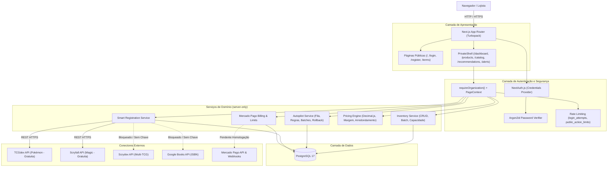

# GEEKPRICE — RELATÓRIO DE AUDITORIA GERAL, DIAGNÓSTICO TÉCNICO E PRONTIDÃO COMERCIAL

**Data da Auditoria:** 13 de Outubro de 2026  
**Avaliador:** Engenharia de Software Sênior, Arquitetura de Sistemas, Segurança da Informação & QA  
**Escopo da Análise:** Código-fonte, configurações, dependências, banco de dados PostgreSQL, testes automatizados e integrações externas do projeto GeekPrice.

---

## 1. RESUMO EXECUTIVO

O **GeekPrice** é uma plataforma SaaS B2B voltada ao comércio de colecionáveis (Pokémon TCG, Magic: The Gathering, mangás e produtos geek). O projeto apresenta uma base técnica com pontos de alta qualidade e maturidade em áreas críticas — com destaque para o motor de precificação em aritmética decimal, a segurança de hashing de senhas com Argon2id, o controle atômico e auditável de concorrência no Autopilot e uma página institucional moderna em Next.js 16.4.

Contudo, a auditoria constatou que o sistema **não está pronto para comercialização pública ou operação em produção**. O GeekPrice encontra-se atualmente no estágio de **MVP Técnico Parcial (Pré-Operacional)**.

Os principais bloqueadores identificados são:
1. **Ausência Total de Inteligência de Preços em BRL (Mercado Brasileiro):** As únicas APIs externas ativas (TCGdex e Scryfall) fornecem cotações internacionais em EUR (Cardmarket) e USD (TCGplayer/Scryfall). O sistema filtra estritamente por cotações em BRL da região BR para alimentar recomendações e o Autopilot; como não existe conector de mercado nacional nem importador de tabelas parceiras em BRL, **o preço de mercado no GeekPrice é sempre nulo (`null`)**. Em decorrência disso, 100% dos produtos caem na trava de segurança (`missing_market_reference`), impedindo a precificação automática pelo Autopilot.
2. **Conflito Arquitetural de SKU e Risco de Vazamento Multiempresa:** No cadastro manual (`createInventoryItem`) e na importação CSV (`createInventoryBatch`), a coluna `product_variants.sku` possui constraint de unicidade global no PostgreSQL (`product_variants_sku_uidx`). Se duas lojas cadastrarem ou importarem produtos distintos com o mesmo SKU interno (ex.: `CARD-001`), o item da segunda loja é atrelado à variante da primeira, corrompendo os metadados do catálogo e gerando colisão entre clientes distintos. Apenas o "Cadastro Inteligente" isola o SKU na organização.
3. **Bloqueio Completo do Fluxo de Cadastro e Cobrança:** O endpoint de registro público (`POST /api/public/register`) está bloqueado intencionalmente com HTTP 503 por falta de credenciais do serviço transacional de e-mail (Resend) e ausência de aprovação jurídica dos termos de uso. O gateway Mercado Pago possui código pronto, mas não possui credenciais configuradas e todos os planos comerciais do banco possuem preço nulo (`monthly_price = null`).
4. **Desconexão do Histórico de Migrations no Drizzle:** A migration `0010_perf_indexes.sql` foi criada e aplicada manualmente via script de scratch, mas **não foi registrada no arquivo `_journal.json` do Drizzle Kit**. Ambientes novos que executarem `npm run db:migrate` ignorarão estes índices de performance.
5. **Componentes e Dados Demonstrativos na Interface:** O gráfico principal de evolução histórica de preços no Dashboard é um SVG estático fixo com dados falsos ("10 set", "15 set", etc.) e seletor de períodos desabilitado. O menu lateral exibe "Autopilot", mas aponta internamente para a rota `/recommendations`. Além disso, a página de Integrações é uma vitrine estática sem possibilidade de autenticação OAuth ou configuração pelo usuário.

---

## 2. AVALIAÇÃO GERAL (SCORECARD TÉCNICO)

| Critério | Nota (0 a 10) | Justificativa Técnica Baseada em Evidências |
|---|---|---|
| **Arquitetura** | **6.5** | Boa separação entre camada de servidor e interface (Next.js App Router). Uso de `server-only`. Contudo, sofre com modelos concorrentes de catalogação (SKU global legado versus identificadores canônicos) e rotas redundantes. |
| **Qualidade do Código** | **7.5** | TypeScript estrito ativo, validações defensivas com Zod em todas as entradas de API, tipagem rigorosa de sessões e Drizzle ORM. Pontos negativos: scripts utilitários deixados na raiz que quebram o lint do projeto (`scratch/`). |
| **Segurança** | **7.0** | Pontos fortes: Hashing de senha impecável com Argon2id + migração transparente de bcrypt; sessões JWT invalidadas por versão de sessão; proteção de rotas privadas e prevenção de IDOR com `requireOrganization()`. Ponto fraco: Rate limiting de login e ações públicas vulnerável a spoofing via cabeçalho `X-Forwarded-For`. |
| **Banco de Dados** | **7.0** | 31 tabelas bem modeladas com constraints e chaves estrangeiras. Pontos críticos: Índice único global em `product_variants.sku` fere o isolamento multi-tenant; migration `0010` órfã do journal do Drizzle. |
| **Performance** | **7.5** | `listInventory` e `listAllInventory` foram refatoradas para eliminar N+1 com subquery agrupada de mercado e joins explícitos. Build Next.js com Turbopack rápido (5.6s). Importação CSV em batch com chunks de 250 itens. Falta paginação no Dashboard principal (carrega lote fixo). |
| **Interface** | **7.0** | Design visual polido, moderno, responsivo e com componentes em Tailwind CSS. Presença de estados de carregamento, erro e estados vazios. |
| **Experiência do Usuário (UX)** | **5.5** | O lojista leigo não consegue conectar ERPs (página de integrações é puramente informativa), o cadastro manual de itens não-TCG é burocrático e o gráfico histórico de preços é fictício, gerando frustração. |
| **Funcionalidades** | **5.5** | CRUD de estoque, importação CSV, catálogo Pokémon/Magic e cálculo decimal funcionam. Recomendações em BRL, Autopilot automático, cobrança e sincronização com e-commerce não funcionam. |
| **Integrações** | **4.0** | TCGdex e Scryfall funcionam perfeitamente para busca e dados internacionais. Zero integrações comerciais com e-commerces (Bling/Nuvemshop/WooCommerce são apenas interfaces sem implementação). Mercado Livre não existe no código. Scrydex e Google Books bloqueados sem chave. |
| **Automação** | **5.0** | Lógica de worker (`runAutopilotReevaluationCycle`) bem estruturada e segura contra conflitos concorrentes, mas inoperante na prática devido à ausência de cotações BRL, o que retém todos os itens como suspeitos. |
| **Testes** | **6.0** | 16 suítes e 54 testes passam no Vitest cobrindo cálculos matemáticos, parsing de CSV, regras e schemas. No entanto, 100% dos testes são unitários com mocks; não há testes de integração E2E ativos no pipeline e o script `verify-auth-flow.ts` está quebrado. |
| **Preparação para Produção** | **4.0** | Build passa, mas faltam Dockerfile da aplicação, infraestrutura de deploy, segredos de produção, monitoramento, políticas jurídicas aprovadas e gateway de pagamento funcional. |
| **Potencial para Validação Comercial** | **5.0** | Existe um excelente nicho para lojas de cards físicos organizarem custos e margens de balcão (piloto assistido), mas a promessa de precificação automatizada em escala exige integrações que ainda não existem. |

**Nota Geral Ponderada: 5.9 / 10**

---

## 3. MAPA REAL DAS FUNCIONALIDADES

| Funcionalidade | Estado Real | Arquivos Responsáveis | Endpoints / Tabelas | Dependências Externas | Evidência Técnica | Problemas Identificados | Ação Recomendada |
|---|---|---|---|---|---|---|---|
| **Login / Sessão** | **FUNCIONAL E TESTADA** | `src/server/auth/*`, `src/components/login-form.tsx` | `/api/auth/[...nextauth]`<br>`users`, `memberships` | Nenhuma (Local) | [options.ts](file:///c:/Users/desk/OneDrive/Desktop/geek-price/src/server/auth/options.ts#L12-L59) valida Argon2id, cria JWT de 8h e revalida membership no DB. | Rate limit pode ser burlado por rotação de `X-Forwarded-For`. | Validar IP real por trás de proxy confiável e limitar por e-mail isolado. |
| **Recuperação de Senha** | **PARCIALMENTE FUNCIONAL** | `src/server/auth/tokens.ts`, `src/app/api/auth/*` | `/api/auth/forgot-password`<br>`auth_action_tokens` | Resend (E-mail) | Tokens SHA-256 de uso único com expiração e invalidação de sessão ([tokens.ts](file:///c:/Users/desk/OneDrive/Desktop/geek-price/src/server/auth/tokens.ts#L63-L75)). | Bloqueado sem `RESEND_API_KEY`. | Configurar credenciais Resend para envio de e-mails. |
| **Cadastro Público** | **BLOQUEADO (CONFIGURAÇÃO)** | `src/server/auth/registration.ts`, `src/app/api/public/register` | `/api/public/register`<br>`organizations`, `users`, `subscriptions` | Resend, Termos Legais | Retorna HTTP 503 defensivo ([route.ts](file:///c:/Users/desk/OneDrive/Desktop/geek-price/src/app/api/public/register/route.ts#L22-L28)). | Requer aprovação jurídica dos termos e chave do Resend. | Definir textos legais definitivos e variáveis no `.env`. |
| **Dashboard (Métricas)** | **FUNCIONAL E TESTADA** | `src/components/dashboard.tsx`, `src/app/(private)/dashboard` | `/dashboard`<br>`inventory_items`, `products` | Nenhuma | Carrega dados reais do PostgreSQL, calcula totais, itens abaixo do mínimo e margem média. | Carrega até 50 produtos fixos sem paginação via backend. | Adicionar paginação e filtros dinâmicos na query do Dashboard. |
| **Dashboard (Gráfico Histórico)** | **DEMONSTRATIVO** | `src/components/dashboard.tsx` | Nenhum (Interface cliente) | Nenhuma | [dashboard.tsx](file:///c:/Users/desk/OneDrive/Desktop/geek-price/src/components/dashboard.tsx#L167-L169) renderiza SVG com curvas estáticas e datas fixas ("10 set", etc.). | Gráfico não reflete dados do banco; dropdown de período desabilitado. | Conectar à tabela `price_observations` agrupada por data. |
| **Estoque (CRUD Manual)** | **FUNCIONAL COM RISCO MULTIEMPRESA** | `src/server/inventory/service.ts`, `src/components/product-manager.tsx` | `/api/inventory`, `/api/inventory/[id]`<br>`inventory_items`, `product_variants` | Nenhuma | Suporta criação, edição de preço/custo e exclusão confirmada. | SKU em `product_variants` é único globalmente; colisão entre lojas distintas. | Desvincular SKU da tabela de catálogo e usar apenas `inventory_items.organization_sku`. |
| **Cadastro Inteligente Pokémon** | **FUNCIONAL E TESTADA** | `src/server/smart-registration/service.ts`, `src/components/smart-registration-modal.tsx` | `/api/smart-registration/card`<br>`product_variants`, `inventory_items` | TCGdex API (Pública) | Busca Pokémon em tempo real via TCGdex e grava metadados canônicos com SKU privado da loja. | Não há cotações em BRL coletadas. | Integrar fonte de cotação em Real brasileiro. |
| **Catálogo Multijogo (Magic & Pokémon)** | **FUNCIONAL E TESTADA** | `src/components/multigame-catalog.tsx`, `src/server/market/*` | `/catalog`, `/api/catalog/cards`<br>`external_listings`, `price_observations` | Scryfall & TCGdex | Pesquisa cartas de Magic (Scryfall) e Pokémon (TCGdex) com seleção de impressão e inserção no estoque. | Outros 4 jogos (Lorcana, One Piece, Gundam, Riftbound) desabilitados. | Contratar API Scrydex para ativar os jogos restantes. |
| **Importação de Estoque CSV** | **FUNCIONAL COM RISCO MULTIEMPRESA** | `src/server/imports/csv.ts`, `src/server/inventory/service.ts` | `/api/imports/preview`, `/api/imports/commit`<br>`import_jobs`, `inventory_items` | Nenhuma | Valida até 2.000 linhas, hashes SHA-256 e executa em chunks de 250 itens. | Utiliza SKU global em `product_variants`; pode corromper catálogo entre lojas. | Ajustar importador para mapear apenas itens do estoque privado. |
| **Exportação CSV** | **FUNCIONAL** | `src/components/dashboard.tsx` | Executado no cliente via Blob | Nenhuma | Gera arquivo CSV contendo os produtos filtrados no momento. | Exporta apenas os itens atualmente carregados na tela. | Criar endpoint de exportação completa via backend. |
| **Motor de Precificação** | **FUNCIONAL E TESTADA** | `src/lib/pricing.ts`, `src/lib/pricing.test.ts` | Funções de cálculo matemático | `decimal.js` | 11 testes aprovados cobrindo markup divisor, taxas, custos adicionais e travas de segurança. | Se mercado for nulo, classifica como `suspicious_flagged`. | Prever modo de precificação por margem pura sem alerta vermelho. |
| **Autopilot (Aprovação em Lote)** | **FUNCIONAL E TESTADA** | `src/server/autopilot/service.ts`, `src/app/api/autopilot/apply` | `/api/autopilot/apply`<br>`price_change_batches`, `price_change_history` | Nenhuma | Transação PostgreSQL com `UPDATE FROM VALUES` e verificação otimista de preço esperado. | Apenas canal "counter" pode ser aplicado; outros canais são simulação. | Modelar precificação multi-tabela para e-commerce e marketplace. |
| **Autopilot (Rollback de Preços)** | **FUNCIONAL E TESTADA** | `src/server/autopilot/service.ts`, `src/app/api/autopilot/rollback` | `/api/autopilot/rollback`<br>`price_change_batches` | Nenhuma | Reverte preços atomicamente e cancela lote se houver alteração posterior. | Requer lote completo sem alterações concorrentes. | Permitir reversão granular por item. |
| **Autopilot Worker Recorrente** | **PARCIALMENTE FUNCIONAL** | `src/server/autopilot/worker.ts`, `scripts/run-autopilot-worker.ts` | `/api/autopilot/cron`<br>`pricing_rules`, `alerts` | Nenhuma | Cron com autenticação Bearer 32+ chars; avalia lojas e regras ativas. | Como preços BRL inexistem, todos os itens são retidos e nunca auto-aplicados. | Ativar fonte de preços BRL para habilitar o piloto automático. |
| **Alertas da Loja** | **FUNCIONAL E TESTADA** | `src/app/(private)/alerts/page.tsx`, `src/components/read-alert-button.tsx` | `/alerts`, `/api/alerts/[id]`<br>`alerts` | Nenhuma | Lista alertas persistidos por organização com marcação de leitura individual via PATCH. | Não há filtros por tipo ou exclusão em massa de alertas. | Implementar filtros e botão "Marcar todos como lidos". |
| **Cobrança Mercado Pago** | **PARCIALMENTE FUNCIONAL** | `src/server/billing/mercadopago.ts`, `src/app/api/billing/*` | `/api/billing/checkout`, `/api/webhooks/mercadopago`<br>`billing_plans`, `subscriptions` | Mercado Pago API | Assinatura HMAC SHA-256 e idempotência de webhooks implementadas com precisão. | Chaves vazias no `.env`; planos no banco com `monthly_price = null`. | Cadastrar credenciais de sandbox e definir valores dos planos. |
| **Integrações ERP / E-commerce** | **SOMENTE INTERFACE / NÃO IMPLEMENTADA** | `src/server/commerce/*`, `src/app/(private)/integrations/page.tsx` | `/integrations`<br>`integration_connections` | Bling v3, Nuvemshop, WooCommerce | [page.tsx](file:///c:/Users/desk/OneDrive/Desktop/geek-price/src/app/(private)/integrations/page.tsx) renderiza cartões informativos estáticos. | Não há fluxo OAuth, não há rotas de conexão e `pullProducts` não possui código. | Desenvolver os clientes HTTP e o fluxo OAuth de cada provedor. |
| **Mercado Livre** | **NÃO IMPLEMENTADA** | Nenhum | Nenhum | Mercado Livre | Apenas documentado em arquivos de pesquisa (`API_RESEARCH.md`). | Zero linhas de código no projeto. | Desenvolver módulo de integração a partir da documentação oficial. |
| **Google Books (ISBN)** | **IMPLEMENTADA, NÃO ATIVADA** | `src/server/catalog/isbn.ts`, `src/app/api/catalog/isbn/route.ts` | `/api/catalog/isbn` | Google Books API | Valida ISBN-10 e ISBN-13 com Bookland; cliente REST implementado. | Desativado por falta de `GOOGLE_BOOKS_API_KEY` e não exposto no formulário de produtos. | Obter chave e criar interface de busca de livros/mangás. |

---

## 4. ARQUITETURA ATUAL E FLUXO DE DADOS

O GeekPrice utiliza a arquitetura moderna baseada no **Next.js 16.4 App Router** com **React 19** e **Drizzle ORM** sobre driver **Postgres.js**.

### Diagrama de Fluxo e Componentes



### Análise dos Módulos:
1. **`src/server/auth`:** Trata criação de sessão, rate limiting e tokens de ação única.
2. **`src/server/inventory`:** Centraliza a persistência de estoque da loja. Utiliza subqueries consolidadas para evitar queries N+1.
3. **`src/server/smart-registration`:** Conecta catálogos externos, gera SKUs sintéticos de variantes e salva o SKU privado da loja.
4. **`src/server/autopilot`:** Motor transacional com auditoria completa de preços e rollback idempotente.
5. **`src/lib/pricing.ts`:** Biblioteca pura com lógica monetária em `decimal.js`, sem acoplamento com banco de dados ou requisições HTTP.

---

## 5. AUDITORIA PROFUNDA DO BANCO DE DADOS (POSTGRESQL)

### 5.1 Inventário de Tabelas e Integridade
O PostgreSQL possui **31 tabelas** criadas no schema `public`.
A integridade referencial utiliza chaves primárias UUID e constraints de chave estrangeira com comportamento explícito:
* `onDelete: "cascade"` em tabelas filhas diretas de `organizations` ou `users`.
* `onDelete: "restrict"` em relacionamentos críticos de estoque (`inventory_items.variantId -> product_variants.id`), impedindo a exclusão acidental de variantes do catálogo com estoque associado.

### 5.2 O Grande Conflito de SKU Multiempresa
O schema em [schema.ts](file:///c:/Users/desk/OneDrive/Desktop/geek-price/src/db/schema.ts#L128) define:
```typescript
export const productVariants = pgTable("product_variants", {
  id: uuid("id").defaultRandom().primaryKey(),
  productId: uuid("product_id").references(() => products.id, { onDelete: "cascade" }).notNull(),
  sku: varchar("sku", { length: 120 }).notNull(),
  ...
}, (table) => [
  uniqueIndex("product_variants_sku_uidx").on(table.sku), // <-- UNICIDADE GLOBAL
  ...
]);
```
**Evidência do Problema:**
No arquivo [inventory/service.ts](file:///c:/Users/desk/OneDrive/Desktop/geek-price/src/server/inventory/service.ts#L65-L71), o cadastro manual de produto executa:
```typescript
const [existing] = await tx.select({ id: productVariants.id })
  .from(productVariants)
  .where(eq(productVariants.sku, input.sku)).limit(1);
```
Se a Loja A cadastra uma carta com SKU `ABC-01` e a Loja B cadastra um board game com o mesmo SKU `ABC-01`, a query encontra a variante da Loja A e vincula o item de estoque da Loja B a ela! Isso causa:
* Corrupção imediata de dados do catálogo da Loja B (exibirá nome e categoria da Loja A).
* Vazamento visual involuntário do código interno de outra empresa.
* Impossibilidade da Loja B cadastrar seu produto com seus próprios metadados se o SKU colidir.

**Solução Arquitetural Necessária:** O SKU da loja deve pertencer exclusivamente a `inventory_items` com uma restrição única composta `(organization_id, organization_sku)`. A tabela `product_variants` deve utilizar apenas identificadores canônicos do catálogo (`canonical_id`, `catalog_source`).

### 5.3 Divergência de Migrations: O Caso da Migration 0010
* Os arquivos físicos em `drizzle/` vão de `0000_misty_overlord.sql` até `0010_perf_indexes.sql`.
* No entanto, o arquivo de controle oficial do Drizzle Kit [drizzle/meta/_journal.json](file:///c:/Users/desk/OneDrive/Desktop/geek-price/drizzle/meta/_journal.json#L70-L75) encerra no índice 9 (`0009_multisoftware_platform`).
* O arquivo `0010_perf_indexes.sql` foi criado após a execução do script `scratch/apply-indexes.ts`, mas **nunca foi gerado ou adicionado pelo Drizzle Kit**.
* **Impacto:** Um deploy em novo servidor que rodar `npm run db:migrate` não aplicará os índices `alerts_org_created_idx` e `price_observations_market_lookup_idx`. Além disso, se o desenvolvedor rodar `npm run db:generate`, o Drizzle Kit tentará gerar uma nova migration 0010 conflitante.

---

## 6. AUDITORIA DE SEGURANÇA DE APLICAÇÃO

### 6.1 Vulnerabilidades Identificadas

#### [VULN-01] Burla de Rate Limiting por Spoofing de Cabeçalho (SEVERIDADE: ALTA)
* **Localização:** [rate-limit.ts](file:///c:/Users/desk/OneDrive/Desktop/geek-price/src/server/auth/rate-limit.ts#L14-L24) e [public-rate-limit.ts](file:///c:/Users/desk/OneDrive/Desktop/geek-price/src/server/auth/public-rate-limit.ts#L14-L24).
* **Descrição:** A função `getLoginOrigin` extrai o IP de `x-forwarded-for` e gera `originHash`. O bloqueio de força bruta em `login_attempts` busca por `WHERE email = $1 AND origin_hash = $2`.
* **Vetor de Ataque:** Um invasor atacando a conta de um administrador pode alternar o cabeçalho HTTP `X-Forwarded-For: 10.0.0.X` a cada 4 tentativas. Como cada requisição gera um `originHash` diferente, o limite de 5 tentativas por hash nunca é atingido para a mesma origem, permitindo ataques de dicionário e força bruta contínuos sem bloqueio da conta.
* **Recomendação:** Implementar trava global de bloqueio por e-mail (independentemente da origem) após 10 tentativas falhas consecutivas e aceitar `X-Forwarded-For` apenas de proxies reversos autenticados/configurados.

#### [VULN-02] Vulnerabilidades Conhecidas em Dependências de Desenvolvimento (SEVERIDADE: MÉDIA)
* **Evidência:** Execução de `npm audit` detectou 9 vulnerabilidades (4 moderadas, 5 altas).
* **Pacotes Afetados:** `braces` (DoS por recursão excessiva via `micromatch` e `eslint-config-next`) e `esbuild` (via `drizzle-kit`).
* **Impacto em Produção:** Baixo, pois afetam a cadeia de compilação/desenvolvimento local, mas devem ser atualizadas assim que as versões upstream corrigirem as dependências.

#### [VULN-03] Ausência de Content Security Policy (CSP) (SEVERIDADE: MÉDIA)
* **Localização:** [next.config.ts](file:///c:/Users/desk/OneDrive/Desktop/geek-price/next.config.ts#L3-L12).
* **Descrição:** O arquivo configura cabeçalhos como `X-Frame-Options: DENY` e `HSTS`, mas não declara cabeçalho `Content-Security-Policy`. Como a interface carrega imagens de múltiplos domínios externos (TCGdex, Scryfall, Google Books), a ausência de uma diretiva CSP explícita aumenta o risco de injeção de scripts (XSS).

### 6.2 Pontos Fortes de Segurança (Validados)
* **Senhas Fortes:** Uso de Argon2id com parâmetros OWASP (m=19456, t=2, p=1).
* **Invalidação de Sessão:** Ao redefinir senha, o campo `users.sessionVersion` é incrementado atomicamente, invalidando todos os tokens JWT ativos imediatamente.
* **Prevenção de IDOR:** Todas as rotas autenticadas usam `requireOrganization()`, que extrai o ID da organização diretamente da sessão validada no banco de dados e aplica filtros rígidos em todas as cláusulas `WHERE`.

---

## 7. ANÁLISE DE PERFORMANCE E GARGALOS

### 7.1 Consultas de Banco e Otimização N+1
* **Status:** A consulta principal de inventário (`listAllInventory` e `listInventory`) foi otimizada para realizar a agregação de cotações em uma subquery única (`market`) com `GROUP BY external_listings.variant_id` e junção direta com `inventory_items` e `products`.
* **Tempo de Execução:** Em banco local com dados pequenos, a execução do plano SQL roda em menos de **3 ms**.
* **Gargalo Identificado para 10.000+ Produtos:** No arquivo [autopilot/service.ts](file:///c:/Users/desk/OneDrive/Desktop/geek-price/src/server/autopilot/service.ts#L258), a função `getAutopilotQueue` chama `listAllInventory(orgId)` e itera item por item em memória (`for (const item of inventory.items)`) executando a correspondência de regras e a matemática do motor. Para estoques com mais de 5.000 itens, essa rotina consome memória significativa e bloqueia o Event Loop do Node.js.

---

## 8. AUDITORIA DAS APIS EXTERNAS E PREÇOS EM BRL

### 8.1 Diagnóstico em Tempo Real das Integrações

| Provedor | Tipo | Status de Conexão Real | Moedas Retornadas | Suporte a BRL (Brasil) | Observação de Campo |
|---|---|---|---|---|---|
| **TCGdex** | Catálogo Pokémon | **ATIVO (200 OK - 687ms)** | EUR (Cardmarket), USD (TCGplayer) | **NÃO** | Catálogo excelente em pt-BR, mas preços refletem mercados europeu e americano. |
| **Scryfall** | Catálogo Magic | **ATIVO (200 OK - 734ms)** | USD, EUR | **NÃO** | Catálogo oficial preciso de impressões. Preços internacionais. |
| **Scrydex** | Multi-TCG Comercial | **INATIVO (Sem chave)** | Depende do plano | Não homologado | Código implementado, aguarda contratação do serviço (a partir de US$ 29/mês). |
| **Google Books** | Mangás / Livros | **INATIVO (Sem chave)** | N/A | N/A | Validador ISBN-10/13 funcional. Requer chave de API e revisão de termos. |
| **Bling ERP v3** | ERP Comercial | **NÃO IMPLEMENTADO** | N/A | Sim (Planejado) | Apenas interfaces TypeScript e encriptador AES definidos. Zero chamadas HTTP. |
| **Nuvemshop** | E-commerce | **NÃO IMPLEMENTADO** | N/A | Sim (Planejado) | Interface definida, nenhum cliente implementado. |
| **WooCommerce** | E-commerce | **NÃO IMPLEMENTADO** | N/A | Sim (Planejado) | Interface definida, nenhum cliente implementado. |
| **Mercado Livre** | Marketplace | **NÃO IMPLEMENTADO** | N/A | N/A | Nenhuma linha de código no projeto. |

### 8.2 A Realidade dos Preços no Brasil
**Fato Técnico:** O GeekPrice atualmente **NÃO POSSUI NENHUMA FONTE DE PREÇOS EM BRL**.
No arquivo `src/server/inventory/service.ts` (linhas 18-19):
```typescript
.innerJoin(priceObservations, and(
  eq(priceObservations.listingId, externalListings.id),
  eq(priceObservations.available, true),
  eq(priceObservations.currency, "BRL"),
  eq(priceObservations.region, "BR")
))
```
Como nenhum conector grava `currency = "BRL"` e `region = "BR"`, a variável `marketPrice` de todos os produtos do sistema é sempre **`null`**.
Isso significa que a funcionalidade principal prometida pela plataforma — **monitorar concorrentes e precificar automaticamente conforme o mercado brasileiro** — não funciona no estado atual do código sem a inserção manual de cotações em Real.

---

## 9. AUTOPILOT E INTEGRIDADE FINANCEIRA

### 9.1 Motor Matemático (`src/lib/pricing.ts`)
* **Fórmula Adotada:** Markup divisor com base na receita líquida:  
  $$\text{Preço Mínimo} = \frac{\text{Custo}}{1 - \text{Taxas} - \text{Custos Adicionais} - \text{Margem Mínima}}$$
* **Precisão:** Toda a aritmética utiliza a biblioteca `decimal.js`, garantindo que não existam erros de ponto flutuante binário comuns do JavaScript.
* **Arredondamento Comercial:** Modos `ends_90` (terminados em ,90), `ends_99` (terminados em ,99) e inteiros funcionam com uma **invariante de proteção rígida**: o preço arredondado nunca pode ficar abaixo do preço mínimo sustentável.

### 9.2 Integridade das Operações em Lote e Rollback
* **Aplicação Concorrente Segura:** Ao aplicar um lote (`applyPriceBatch`), o sistema utiliza uma query `UPDATE ... FROM (VALUES ...) WHERE i.id = v.id AND i.price = v.expected_price`. Se o preço de qualquer produto tiver mudado no banco durante o intervalo entre a visualização e o clique de aprovação, a transação aborta inteiramente com `AutopilotConflictError`, garantindo que não haja atualizações financeiras parciais ou desatualizadas.
* **Rollback Auditável:** O rollback (`rollbackPriceBatch`) verifica se o preço atual coincide exatamente com o preço que o lote aplicou. Se o lojista já tiver alterado manualmente o preço de um item após a aplicação do lote, o rollback é rejeitado para evitar sobrescrita de dados recentes.

---

## 10. SIMULAÇÃO DO FLUXO DO LOJISTA (CENÁRIOS A A F)

| Cenário | Descrição da Experiência | Resultado Técnico | Evidência e Obstáculos |
|---|---|---|---|
| **A. Primeiro Acesso** | Login com conta administrativa existente | **APROVADO COM RESSALVAS** | Login via NextAuth funciona; Dashboard abre e exibe métricas corretas. Ressalva: o gráfico central é estático com datas antigas ("set/out"). |
| **B. Cadastro de Produto** | Buscar carta Pokémon no catálogo e cadastrar | **APROVADO** | O Cadastro Inteligente busca via TCGdex, preenche nome, raridade e imagem. O lojista informa apenas custo, preço, estoque e margem. Persistência confirmada. |
| **C. Inteligência de Preços** | Visualizar referências e recomendações em BRL | **REPROVADO** | As referências exibidas são em EUR e USD. Como não há conversão para BRL, o motor sinaliza "Sem cotação externa" e a recomendação fica restrita à margem de custo. |
| **D. Autopilot** | Simular oportunidade, aprovar lote e fazer rollback | **PARCIALMENTE APROVADO** | As regras e a lógica transacional funcionam; lote e rollback persistem no log. Porém, como todos os itens caem na trava por falta de mercado, a aprovação automática de fundo é inerte. |
| **E. Importação CSV** | Upload de arquivo CSV de estoque | **APROVADO COM RESSALVA CRÍTICA** | Validação sintática rápida, detecta duplicidade de arquivo por hash. Ressalva crítica: o risco de colisão de SKU com variantes globais de outras lojas. |
| **F. Isolamento Multiempresa** | Duas organizações acessando seus dados | **PARCIALMENTE APROVADO** | Rotas privadas isolam perfeitamente `inventory_items` por organização. Falha no catálogo global: produtos com o mesmo SKU sobrescrevem metadados. |

---

## 11. MATRIZ DE PROBLEMAS ENCONTRADOS

### Bloqueadores Críticos (Prioridade P0)
1. **Colisão Global de SKU no Catálogo:** `product_variants.sku` é único globalmente no PostgreSQL. Impede que lojas diferentes utilizem códigos internos iguais e provoca associação incorreta de produtos na importação CSV e cadastro manual.
2. **Inexistência de Cotações em BRL:** Inviabiliza a promessa de inteligência de mercado no Brasil. O Autopilot retém todos os produtos como suspeitos (`missing_market_reference`).
3. **Cadastro Público e Cobrança Inoperantes:** O registro está desativado com HTTP 503 (sem Resend e sem aprovação de termos) e o checkout do Mercado Pago não possui preços nos planos nem credenciais ativas.

### Alta Prioridade (Prioridade P1)
4. **Migration 0010 Não Rastreada no Journal:** A migration `0010_perf_indexes.sql` está fora do controle de versão do Drizzle Kit (`_journal.json`), gerando inconsistências em novos deploys.
5. **Vulnerabilidade no Rate Limiting de Autenticação:** Possibilidade de evasão do limite de tentativas de login através da manipulação do cabeçalho `X-Forwarded-For`.
6. **Scripts de Teste Quebrados:** `verify-auth-flow.ts` falha porque assume que a rota `/` redireciona para o login, mas agora a rota `/` é uma Landing Page pública.
7. **Falha de Linter no Projeto:** A pasta `scratch/` não foi ignorada no `eslint.config.mjs`, provocando falha no comando `npm run lint`.

### Média Prioridade (Prioridade P2)
8. **Gráfico do Dashboard Fictício:** Visual em SVG com coordenadas estáticas e períodos desabilitados.
9. **Código Abandonado no Projeto:** O componente `recommendations-view.tsx` e o serviço `src/server/recommendations/service.ts` foram substituídos pelo `AutopilotView`, mas continuam no repositório.
10. **Desvio Semântico na Navegação:** O item do menu lateral chama-se "Autopilot", mas aponta internamente para a URL `/recommendations`.

### Melhorias Futuras (Prioridade P3)
11. **Falta de Containerização da Aplicação:** Ausência de `Dockerfile` para o Next.js (apenas PostgreSQL está no Docker Compose).
12. **Ausência de CSP (Content Security Policy) no `next.config.ts`.**
13. **Paginação em Memória no Autopilot:** Necessidade de paginação direta no PostgreSQL para estoques acima de 5.000 itens.

---

## 12. RISCOS PARA COMERCIALIZAÇÃO DO SAAS

Se o GeekPrice fosse colocado à venda hoje na internet:
1. **Frustração Imediata e Reembolsos (Churn):** O lojista brasileiro assinaria a plataforma esperando ver os preços de concorrentes no Brasil e encontraria "Dados indisponíveis" ou referências em Euro/Dólar.
2. **Risco de Corrupção de Estoque:** Ao importar sua base de estoque via CSV, o lojista poderia ter itens misturados com descrições cadastradas por outras empresas caso seus códigos internos coincidissem.
3. **Bloqueio de Faturamento:** Novos clientes não conseguiriam finalizar o cadastro e o sistema não conseguiria processar a cobrança do cartão de crédito.
4. **Risco Jurídico (LGPD e CDC):** As páginas de Termos de Uso e Política de Privacidade são rascunhos com marcações explícitas de pendência jurídica.

---

## 13. ROADMAP PRIORITÁRIO DE DESENVOLVIMENTO

### Horizonte A — Correções Essenciais e Estabilização
* **Objetivo:** Eliminar riscos arquiteturais, alinhar o banco e restaurar a integridade técnica.
* **Tarefas:**
  1. Refatorar o modelo de dados de catálogo: remover o índice único global de `product_variants.sku`, tornando o SKU propriedade estrita de `inventory_items` isolada por `organization_id`.
  2. Ajustar `drizzle/meta/_journal.json` para registrar formalmente a migration `0010_perf_indexes.sql`.
  3. Adicionar a pasta `scratch/` na lista de ignores do ESLint (`eslint.config.mjs`) e atualizar `scripts/verify-auth-flow.ts` para testar o fluxo da landing page pública.
  4. Corrigir o rate limit de login para travar tentativas por e-mail independentemente de rotações de IP.
  5. Remover ou consolidar os arquivos obsoletos (`recommendations-view.tsx`).

### Horizonte B — MVP Comercial Real (Pronto para Venda Piloto)
* **Objetivo:** Permitir que lojas reais utilizem o sistema com inteligência prática de mercado e cobrança ativa.
* **Tarefas:**
  1. **Solução de Cotações em BRL:** Criar conector para importação de tabelas de preços em BRL de distribuidores/parceiros ou integrar um serviço de cotação nacional autorizado.
  2. **Ativação da Cobrança:** Homologar o fluxo do Mercado Pago em sandbox, configurar credenciais no `.env` e cadastrar os valores reais dos planos (`monthly_price`).
  3. **Aprovação Jurídica:** Redigir versões definitivas dos Termos de Uso e Política de Privacidade, ativando `LEGAL_DOCUMENTS_APPROVED=true`.
  4. **Ativação de Mensageria:** Configurar `RESEND_API_KEY` para liberar o envio de confirmação de e-mail e recuperação de senha.
  5. **Gráfico Real:** Conectar o gráfico do Dashboard às observações históricas da tabela `price_observations`.

### Horizonte C — Expansão e Escala
* **Objetivo:** Diferenciação de mercado e expansão do portfólio.
* **Tarefas:**
  1. Contratar Scrydex para ativar Lorcana, One Piece, Gundam e Riftbound.
  2. Desenvolver conectores OAuth reais com Bling v3 e Nuvemshop para sincronização bidirecional de estoque.
  3. Integrar módulo Google Books com chave de API para o nicho de mangás e quadrinhos.
  4. Criar Dockerfile de produção com build multi-stage e pipeline de CI/CD.

---

## 14. RESPOSTA DIRETA ÀS 20 PERGUNTAS OBRIGATÓRIAS

### 1. Qual é o estado real do GeekPrice hoje?
O GeekPrice é um **MVP Técnico Parcial**. A fundação (autenticação com Argon2id, controle de permissões por organização, CRUD de estoque, motor de cálculo decimal e lógica atômica do Autopilot) está implementada com alto padrão de qualidade de código. Porém, faltam os conectores de mercado em moeda nacional (BRL), a cobrança ativa e a resolução do conflito de SKU entre lojas.

### 2. Qual porcentagem aproximada do MVP comercial está concluída?
**Aproximadamente 60%.**  
*Método de estimativa:* Ponderação dos módulos indispensáveis para a venda de um SaaS B2B:
- Autenticação e Multi-tenant: 90%
- Catálogo e Estoque: 70% (penalizado pelo conflito de SKU)
- Inteligência de Mercado Nacional: 10% (apenas USD/EUR existem)
- Motor de Precificação e Autopilot: 75% (inativo por falta de dados BRL)
- Cobrança Recorrente e Assinaturas: 45% (código pronto, mas sem homologação e sem preços)
- Jurídico, Comunicação e Onboarding: 50% (bloqueado por configuração)

### 3. O que está 100% funcional e testado?
O login com senha em Argon2id com migração automática de bcrypt; o motor matemático de precificação com `decimal.js` (markup divisor e arredondamento comercial); a transação atômica de aprovação de preços com controle de concorrência e rollback; o catálogo de Pokémon (TCGdex) e Magic (Scryfall); e a central de alertas com marcação individual de leitura.

### 4. O que ainda utiliza dados fictícios?
O gráfico de evolução histórica de preços do Dashboard (`PriceChart` em `dashboard.tsx`), que renderiza um SVG com coordenadas e datas fixas ("10 set", etc.).

### 5. O que está implementado apenas visualmente?
A página de **Integrações** (`/integrations`), que apenas exibe cards estáticos sem permitir autenticação ou conexão; e os canais "E-commerce" e "Marketplace" no Autopilot, que estão codificados explicitamente apenas para simulação visual.

### 6. Quais APIs realmente funcionam?
**TCGdex** (Pokémon) e **Scryfall** (Magic: The Gathering). Ambas respondem em tempo real (menos de 800ms) sem necessidade de chaves pagas. Todas as demais (Scrydex, Google Books, Bling, Nuvemshop, WooCommerce, Mercado Livre) estão inativas ou não implementadas.

### 7. O GeekPrice consegue obter preços confiáveis em BRL?
**Não.** Nenhuma API conectada fornece dados do mercado brasileiro em Real. As cotações obtidas são exclusivamente em EUR (Cardmarket) e USD (TCGplayer/Scryfall). O sistema filtra por `currency = 'BRL'`, resultando sempre em ausência de dados externos para lojistas nacionais.

### 8. O cadastro de produtos está suficientemente automatizado?
Para cartas de Pokémon e Magic, **sim**: o "Cadastro Inteligente" preenche automaticamente nome, edição, raridade, número e imagem oficial. Para produtos fora destes dois jogos (board games, mangás, figures), o cadastro é 100% manual e burocrático.

### 9. O motor de precificação é matematicamente confiável?
**Sim, totalmente confiável.** Utiliza a fórmula de markup sobre a receita com `decimal.js`, considera taxas de marketplace e custos adicionais, possui invariantes que impedem que o preço fique abaixo do mínimo rentável e oferece arredondamentos comerciais seguros.

### 10. O Autopilot funciona com integridade financeira?
A camada de persistência e rollback possui integridade financeira impecável (bloqueia atualizações se os preços mudarem concorrentemente). Contudo, **o piloto automático contínuo de fundo não altera preços**, pois a ausência de mercado em BRL faz com que 100% dos produtos sejam retidos como suspeitos.

### 11. Existem riscos de vazamento de dados entre lojas?
Sim, no nível do **catálogo de produtos**. Como o SKU em `product_variants` é único globalmente no banco de dados, o cadastro manual ou a importação via CSV por lojas distintas com códigos idênticos provoca a vinculação cruzada à mesma variante do catálogo, misturando títulos e categorias.

### 12. Existem problemas graves de performance?
Não há problemas graves de N+1 no banco local. Contudo, em estoques grandes (10.000+ itens), o Autopilot carrega todos os produtos na memória do processo Node.js para aplicar as regras, o que causará alto consumo de memória e latência de resposta.

### 13. O banco PostgreSQL está corretamente estruturado?
Possui uma estrutura robusta de 31 tabelas e chaves estrangeiras consistentes. Porém, apresenta duas falhas de gestão: o índice único global em `product_variants.sku` e o esquecimento do registro da migration `0010` no arquivo `_journal.json`.

### 14. Existem vulnerabilidades relevantes?
Sim. A vulnerabilidade de **Evasão de Rate Limiting** em endpoints de login e autenticação através da injeção arbitrária do cabeçalho `X-Forwarded-For`.

### 15. O sistema pode ser publicado na internet com segurança?
**Não neste momento.** Publicar o sistema hoje exporia o serviço a ataques de força bruta no login, risco de colisão de catálogo entre clientes e falha no processo de cobrança e cadastro de novos assinantes.

### 16. Um lojista conseguiria utilizá-lo sem suporte técnico?
**Apenas parcialmente.** O lojista consegue navegar, cadastrar cartas e ver sugestões baseadas no seu próprio custo. Contudo, ele não entenderá por que o gráfico histórico não muda, por que as cartas dizem "Sem cotação de mercado" e não conseguirá conectar sua loja virtual ou ERP.

### 17. Qual é o maior problema atual?
A **desconexão entre a proposta de valor e a realidade dos dados**: o sistema se posiciona como um SaaS de precificação inteligente automática para lojas brasileiras, mas não possui nenhuma fonte de dados do mercado brasileiro em BRL.

### 18. Quais são as cinco correções mais importantes?
1. Desvincular o SKU global de `product_variants` e isolá-lo em `inventory_items` por organização.
2. Integrar uma fonte de cotação ou importador de listas parceiras em BRL.
3. Registrar a migration `0010` no `_journal.json` do Drizzle Kit.
4. Corrigir o rate limiter para bloquear tentativas de autenticação por e-mail de forma absoluta.
5. Homologar as credenciais do Mercado Pago e configurar os preços reais dos planos comerciais.

### 19. O que falta para vender o GeekPrice?
Fonte de preços em BRL, correção do isolamento de SKU, gateway de pagamento homologado com planos precificados, serviço transacional de e-mail (Resend) configurado, termos jurídicos aprovados e um `Dockerfile` de produção.

### 20. Qual deve ser exatamente a próxima fase de desenvolvimento?
A próxima fase deve ser a **Fase de Estabilização e Validação do Mercado Nacional (Fase 8)**:
1. Resolução do modelo multi-tenant de SKU no banco.
2. Implementação de um módulo de importação de cotações parceiras em BRL (via planilha ou API nacional).
3. Homologação do checkout e webhook Mercado Pago em ambiente Sandbox.
4. Abertura controlada para um **programa piloto fechado com 3 a 5 lojas físicas reais**.
